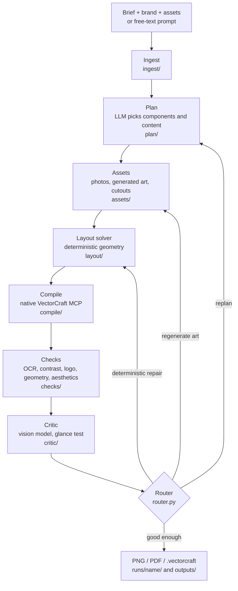
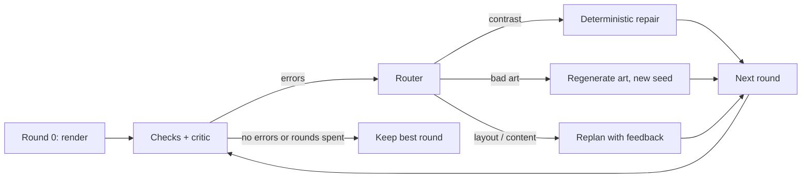
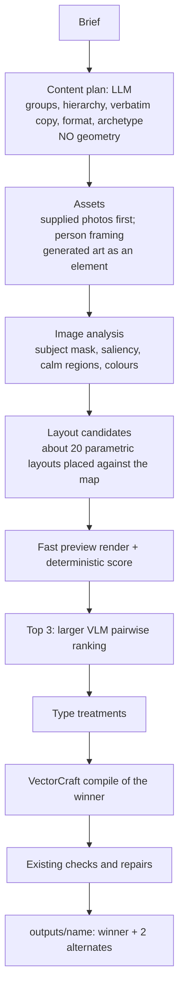

# Poster Agent: architecture

A plain-language, end-to-end description of how the agent turns an event request into a finished poster, which model does what, where
each one runs, and what changes in the next stage. Sections marked **(built)** exist and are tested today; **(next)** is the approved
Stage 3 design (see the plan file) and is not built yet.

---

## 1. What the system does

**Input:** an event brief (title, date, venue, speakers, tagline, contact lines, style wishes), a brand profile (colours, fonts, logo rules),
and optional supplied files (logos, photos), or just a free-text prompt (`run_poster.py --prompt "..."`).

**Output:** a brand-correct poster as `PNG`, `PDF` and an **editable `.vectorcraft` document** (real vector text and shapes, named
layers, locked logo) so a designer can still touch it up by hand.

**Design promise (the guardrails, enforced by `tests/test_guardrails.py`):**

1. The agent never runs its own MCP server. VectorCraft is driven through its native `vectorcraft-cli mcp`; our code is only a client.
2. One source of truth: the `PosterSpec`. Stages read and write it; conflicts become typed `Issue`s routed to the owning stage.
3. **Every printed word comes from the brief or brand profile.** The language model never invents poster copy.
4. Logos and photos of people are **never generated or altered by diffusion**; they are only cropped, masked or colour-treated as brand rules allow.
5. No per-brief hacks: behaviour comes from brand profiles, component definitions or the plan.
6. Reports state only what a check actually measured.

---

## 2. The big picture



The important idea: **the language model only chooses; it never places anything.** It names components and fills them with verbatim
text. All coordinates come from deterministic code, so the result can be measured, checked and repaired.

---

## 3. The data that flows between stages

| Object | Defined in | What it is |
|---|---|---|
| `Brief` | `ingest/brief.py` | The requester's facts: title, date, venue, speakers, contact lines, style notes. |
| `BrandProfile` | `spec/brand.py`, `brands/<school>/brand.yaml` (not in the public repo) | Palette, fonts, logo variants and rules (clear space, max size, forbidden grounds), allowed decorations, footer defaults. |
| `PlanOutput` | `plan/schema.py` | What the planner returns: format, background, `ComponentSpec`s, generated-asset requests, align / type style / template. **No coordinates.** |
| `ComponentSpec` | `spec/models.py` | "Put a `HeaderRow` here with these lines": a component name, content, emphasis, anchor and (new) a `zone`. |
| `PosterSpec` | `spec/models.py` | The single source of truth: canvas, palette, fonts, background, components, assets, **placed elements**, mandatory items, issues, overrides. |
| `PlacedElement` | `spec/models.py` | One drawable thing with an exact box: text, image, shape. The compiler draws these and nothing else. |
| `Issue` | `spec/models.py` | A typed problem (`low_contrast`, `text_overlap`, `fit`, `mandatory_missing`, `dead_space`...) with evidence and an owning stage. |

---

## 4. Stage by stage

### 4.1 Ingest (built)
`ingest/brief.py` loads `brief.yaml`, or extracts one from free text (`extract_brief`). Extraction is verbatim-pruned: any string the model
returns that is not found word-for-word in your message is dropped and listed. `ingest/assets.py` scans `assets/` (files named
`kind__label.ext`) into an inventory.

### 4.2 Plan (built)
`plan/planner.py` asks a text LLM for a `PlanOutput`. The prompt (`plan/prompt.py`) contains the formats, the brand, a catalogue of
components, the asset inventory, a composition recipe chosen for the genre, short design skills (`skills/*/SKILL.md`), and the brief.

The plan is then **validated** (`plan/validate.py`): every brief field must appear verbatim, logos must follow brand rules, components must
exist, zones must exist. Problems are fed back to the model for up to three rounds. Then the layout solver runs; if content does not fit it
reports a typed `fit` issue that goes back to the model too, and `_compact` first tries to shrink the plan deterministically.

**Which model plans?** A fresh, tool-less session of a local command-line LLM agent per request (`llm/cli_llm.py`, set with `PLANNER_CLI`): a new session with only our system and
user prompt, no tools, no project files, no memory, no saved session, run from an empty folder. It falls back to Gemini and Groq if
the CLI is unavailable. (Decision made on 2026-11-04 because the free tiers fail most live runs.)

### 4.3 Assets (built)
`assets/generate.py` talks to **ComfyUI** (on the GPU PC) through `assets/comfy.py`:

| Need | Model | Notes |
|---|---|---|
| Background art | **Flux 3 Klein** | Text-free atmospheric image. Seams are screened out; `assets/treatments.py` can calm it (per-aspect: saturation, contrast, detail). |
| Hero object | **Qwen-Image 2.1** | Object on plain ground, then cut out locally with `rembg`. |
| Cutout / matte | `rembg` (isnet-general-use), CPU | **(next)** replaced by BiRefNet; portrait variant for people. |
| Supplied photos | none | Only crop / duotone / fade. Never regenerated. |

Everything generated is cached by request and keeps its seed and prompt, so reports state exactly what produced each image.

### 4.4 Layout solver (built; the part being redesigned)
`layout/solver.py` turns `ComponentSpec`s into `PlacedElement`s with no LLM.

- **Components** (`layout/components.py`, `layout/structure.py`) each own their geometry: `LogoBlock`, `TitleStack`, `BigTitle`, `HeaderRow`,
  `IconRow`, `Columns`, `HeroImage`, `PhotoFade`, `InfoBar`, `TextBlock`, `SpeakerGrid`...
- **Context** (`Ctx` in `layout/base.py`): one alignment axis, a type style preset (`classic`, `bold`, `elegant`, `editorial`, `condensed`), a
  type scale with role size caps, and the real ground colour.
- **Templates** (`layout/zones.py`): `classic` (one top-to-bottom stack), `stage`, `two_col`, `top_art` (named zones; a zone that needs more
  height grows and borrows from the zones below).
- If content does not fit, type scales down globally (never below role floors); if it still does not fit, a `fit` Issue is raised.
- **Adaptation to the real background** (`layout/adapt.py`): text colour re-chosen against pixels, soft gradient backing bands where
  text sits on busy art, and an art-to-band fade so images never hard-cut at an edge band.
- Text width is measured with the real fonts (`layout/fonts.py`), calibrated to VectorCraft within ~1.4%.

#### 4.4b Look at the art, then place the text (built, 2026-11-04)
After the background art exists, `analysis.py` measures it (how busy each area is, where its subject is) and `layout/candidates.py` tries
many placements of the same content against that map: left / right / full-width column, upper / middle / lower window, content packed
top / middle / bottom, then **refines the winner continuously** (nudging the region edges) while each candidate is solved by the normal
deterministic solver, so it is either a legal layout or dropped. The score is measured, not guessed: busy texture and subject overlap under
the text, text on the subject's side, a squeezed block, a logo floating mid-poster, text inside the art-to-band fade zone. The planner's
own placement is kept unless another beats it clearly. A leading header / logo strip is pinned to the top margin; cutout heroes are drawn
without a card; `TitleStack.title_style` (`accent_last`, `accent_first`, `weight_split`) gives colour / weight contrast between title lines.

**Why not fixed archetypes only?** A fixed archetype list can only ever produce its own handful of layouts. The research (content-aware
layout work, energy-based layout optimisation, PLAYGROUND, LayoutPrompter) points the other way: let positions be continuous variables
chosen by optimising measurable costs against the real art, and use archetypes only as starting points. That is what the search + refine
above does for the text region; moving individual groups (title, details, hero) independently is the next step.


#### 4.4c Other Stage 3 pieces (built 2026-11-04; unit-tested, not yet all run live)
- **Planner dead-space feedback** (`plan/planner._sparse_errors`): on plain grounds the planner is told, before anything is rendered, if its layout
  would leave too much empty space (estimated from the planned boxes; it matched the measured result on every plain-ground poster in the evaluation
  that failed). One chance to improve; the legal plan is kept if it cannot.
- **QRBlock**: a vector QR generated from a URL that must appear in the brief (`layout/qr.py`, segno), placed like an icon; never an AI image.
- **Balanced line breaks** for headlines (`TextMeasurer.wrap_balanced`): same line count, even lines, no stub on the last line.
- **Person photo framing** (`assets/person.py`): `framing: head | head_and_shoulders | half_body` on ChiefGuestCard / SpeakerGrid. Crops the
  supplied photo (never repainted); the head is found with the YuNet face detector if its model file is installed, else from the person's matte.
  A photo that does not extend far enough is reported as `limited`, not faked.
- **Variants** (`run_poster.py --variants N`, `variants.py`): N designs with different composition recipes, ranked by what was measured.
- **Local page** (`python -m poster_agent.webapp`): paste a requirement, get the poster; standard library only, bound to 127.0.0.1.
- **Evaluation** (`scripts/evaluate.py`, `eval/briefs/`): 12 fictional briefs; produced / passed counts, failed checks, contact sheet.
- **Helper MCP server** (`agent_tools/poster_tools.py`): measure / check tools for a model that designs directly in VectorCraft
  (`scripts/freehand_run.py` experiment; not part of the main pipeline).

### 4.5 Compile (built)
`compile/compiler.py` + `compile/vc_client.py` translate placed elements into **native VectorCraft MCP** calls and export PNG, PDF and
`.vectorcraft`. Objects are named after element ids, logos are locked, decorations grouped. Watch mode (`--watch`) can draw live in the
VectorCraft window and `--finalize` maps your hand edits back.

### 4.6 Checks (built)
`checks/runner.py` measures the render, never assumes:

- **OCR** per text element and over the whole image (mandatory text present? stray text present?), with look-alike folding (0/O, 1/I/l)
  and per-line re-reads.
- **Contrast** at the worst pixel percentile under each text (WCAG).
- **Logo rules**: fidelity, minimum size, clear space, flat field.
- **Geometry**: real bounds vs safe area and overlaps; VectorCraft overflow and font warnings.
- **Emptiness** (dead space, calibrated on designers' posters) and **aesthetics** (`checks/aesthetics.py`: title dominance, logo
  proportion, repeated text, container fill, alignment axes).
- Tamil text is reported "unverifiable", never failed (OCR cannot read it).

### 4.7 Critic, router, repairs (built)
- `critic/critic.py` + `critic/probes.py`: the vision model (today **LFM3-VL-2B**, local) runs a *glance test*: read the title and date from a
  300px thumbnail and compare with the brief, plus pairwise A/B preference with order swapped. It does not give made-up scores.
- `router.py` sends each issue to its owner: contrast → `repairs.py` (deterministic recolour), art problems → regenerate art, render
  problems → recompile, the rest → replan. Repairs that fail escalate.
- The loop in `pipeline.py` runs up to `--rounds` rounds, keeps the best round, and the report says whether the kept poster actually
  passed.
- `polish.py` (opt-in): a model proposes a few allow-listed fine touches (move, resize, recolour, opacity), kept only if checks do not worsen.

### 4.8 Outputs (built)
Each run writes `runs/<name>/` (`plan.json`, `spec.json`, `report.json` with every seed and prompt, the poster files). `outputs/` receives
the final PNG of **real runs that passed their checks** only; it never overwrites an earlier image (`name.png`, `name_2.png`...) and
`outputs/index.json` records the honest status of each.

---

## 5. Which model runs where

| Job | Model | Runs on | Called from |
|---|---|---|---|
| Plan, brief extraction | CLI agent session (fresh per call) → Gemini → Groq fallback | Cloud | `llm/cli_llm.py`, `llm/gemini.py`, `llm/groq.py` |
| Background art | Flux 3 Klein | GPU PC (RTX 4090) via ComfyUI `:8188` | `assets/` |
| Hero cutout | Qwen-Image 2.1 | GPU PC via ComfyUI | `assets/` |
| Matting | rembg isnet (now) → BiRefNet (next) | Local PC (CPU now) | `assets/matting.py` |
| Critic / glance test | LFM3-VL-2B (now) → larger VLM (next) | GPU PC, OpenAI-compatible `:8080` | `llm/openai_vlm.py` |
| Text OCR for checks | RapidOCR | Local PC | `checks/ocr.py` |
| Drawing, export | VectorCraft CLI (not a model) | Local PC | `compile/` |

**VRAM scheduling (RTX 4090, 24 GB):** ComfyUI models and the critic VLM cannot be resident together. The run therefore goes in
phases: generate all art first, free that GPU memory, then start critiquing. The critic server should be started with a small context
(8K tokens is enough; a poster image costs ~1–2K tokens).

---

## 6. The refinement loop



Rounds are ranked by (number of errors, critic result, dead space). The report states if the kept poster passed, and whether a vision
review backed it. A poster that did not pass is not copied to `outputs/`.

---

## 7. Known weaknesses of today's flow (why Stage 3)

1. **Layout is decided before the art exists.** The planner picks a template, art is generated "around" it, and the text is then adapted
   (recolour, scrims, calming). A slightly different background still gets text in the same spot.
2. **One candidate, repaired**, instead of several candidates compared.
3. **Rigid geometry:** fixed template fractions; the LLM has no spatial perception of the art.
4. **Plain typography:** one fill colour per text, only size/weight presets.
5. **No measured quality**: checks prove legality (contrast, OCR, margins), not good design; no evaluation set yet.
6. **Small critic:** a 2B model cannot judge balance or taste, only whether text is readable.
7. **Format defaults:** square formats are cramped; 84% of real posters are tall 9:16.
8. **People photos** are not reframed (no head-and-shoulders crop); matting is weak on hair.

---

## 8. Stage 3: the next design (planned)



What changes and why:

- **Look at the image, then place the text.** Content-aware layout research (PosterLayout, VASCAR, iPoster) and agentic systems (PLAYGROUND)
  all analyse the picture first and penalise text over the subject or busy texture.
- **Generate several layouts, render them quickly, pick the best.** A fast preview renderer (from the same placed elements and the same
  text measurer) lets us score ~20 candidates cheaply; VectorCraft stays the final compiler only.
- **A real critic.** A larger vision model (Qwen3-VL 32B class) ranks the top candidates pairwise; the rule-based score remains the backbone.
- **Type treatments.** Accent word, outlined numeral, highlight bar, eyebrow label, vertical side label, gradient or image-filled big word,
  all as editable VectorCraft text, chosen by the planner from a brand allow-list; the OCR and contrast checks still run.
- **Person photos.** Pose and face landmarks choose a framing preset (`head`, `head_and_shoulders`, `half_body`), BiRefNet-portrait cuts
  the person out, a shape mask finishes it. No diffusion on faces.
- **Formats.** Tall 9:16 default, then 4:5; square only when the brief asks for a feed post.
- **Evaluation set.** 15 to 20 briefs and `scripts/evaluate.py`, so every change is accepted only if scores do not drop.

---

## 9. How to run it

```powershell
# from a brief folder
.venv\Scripts\python.exe run_poster.py briefs\<name> [--no-gen] [--no-critic] [--rounds N] [--polish]

# from free text (saved to briefs/<name>/brief.yaml first)
.venv\Scripts\python.exe run_poster.py --prompt "..." --brand kct --format story

# replay a saved plan without any LLM (testing)
$env:PYTHONPATH="."; .venv\Scripts\python.exe scripts\replay_plan.py <brief> --plan <plan.json> --run-name <name>
```

Tests: `python -m pytest -q` (fast, ~1 minute); `python -m pytest -q -m slow` runs the VectorCraft render tests.

---

## 10. Glossary

- **Component:** a layout building block that owns its geometry (title, header row, icon row...).
- **Zone / template:** a named region of the poster; a template is a set of zones.
- **Ground:** the actual colour or picture behind the text.
- **Calm region:** an area of the background with low texture and contrast where text can sit.
- **Glance test:** can the title and date be read from a small thumbnail?
- **Round:** one render + check + repair pass in the refinement loop.
